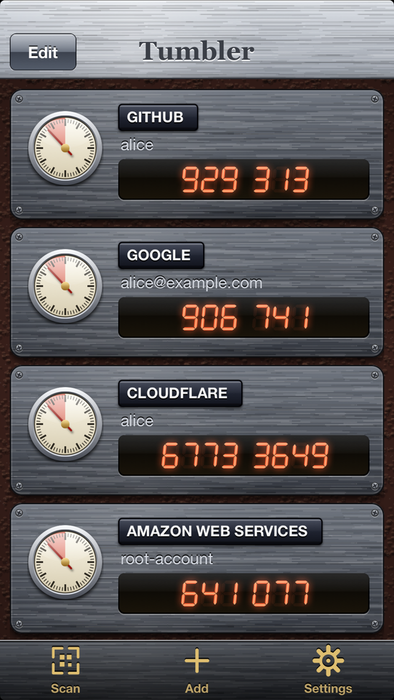
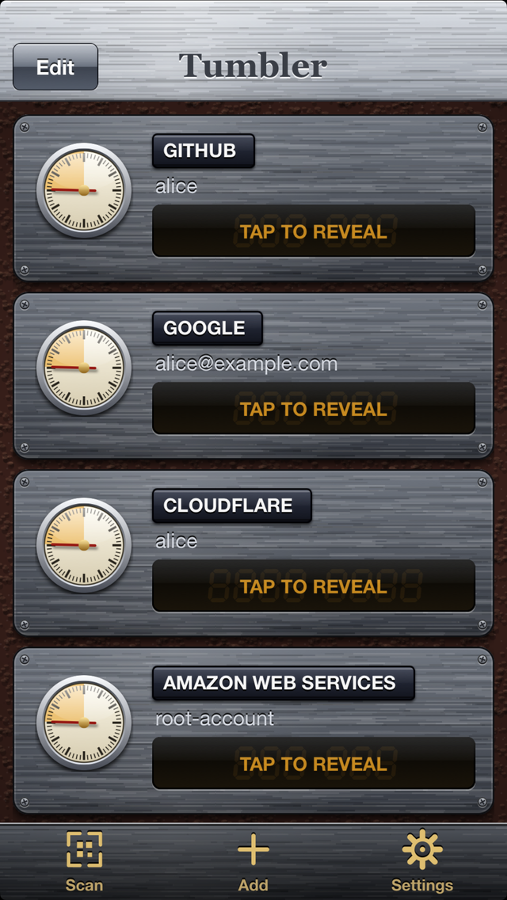
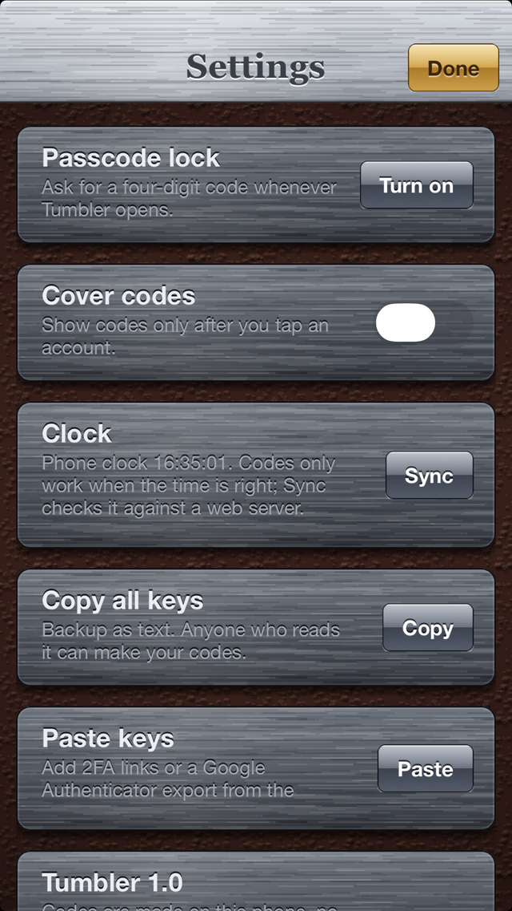
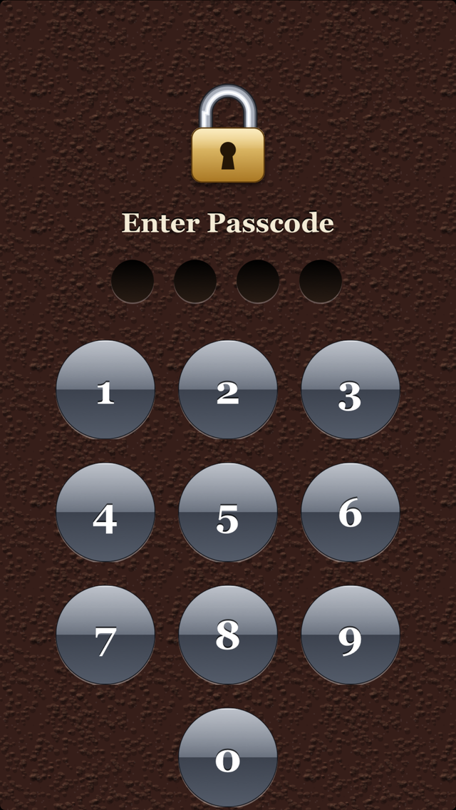

# Tumbler

An offline two-factor authenticator (TOTP and HOTP) for **iOS 6**, written for an iPhone 5 that no current authenticator app
supports any more. Codes are computed on the phone from the secret keys you add; there is no account, no cloud and no
server component. The look is skeuomorphic: brushed-steel plates, a leather background, amber LED digits and a countdown dial per account.

The screenshots come from the simulator build with made-up demo accounts (`TB_DEMO=1`, see [Simulator preview](#simulator-preview)).

## Features

- Time-based (RFC 6238) and counter-based (RFC 4226) codes; SHA-1, SHA-256 and SHA-512; 6, 7 or 8 digits; any refresh period
  (15, 30 and 60 s can be picked in the editor, other periods from a QR code are kept as they are).
- Adding accounts:
  - scan a QR code with the camera (decoded with the bundled [quirc](third_party/README.md) library, with a torch button and near-range autofocus),
  - pick a screenshot or photo of a QR code from the photo library,
  - type a secret key by hand (base32, spaces and dashes are ignored),
  - paste from the clipboard, or open an `otpauth://` link (the app registers the `otpauth` and `otpauth-migration` URL schemes).
- Import of `otpauth://totp/...`, `otpauth://hotp/...` and Google Authenticator `otpauth-migration://offline?data=...` export links
  (several accounts at once; accounts with a key that is already present are skipped).
- Edit, reorder and delete accounts; HOTP accounts have a push knob that advances the counter and copies the new code.
- Tap an account to copy its current code (HOTP accounts copy on the knob press instead).
- Optional four-digit passcode, asked on launch and whenever the app goes to the background (the screen is covered before iOS takes its
  multitasking snapshot).
- "Cover codes" mode: codes stay hidden until an account is tapped, then show for 15 seconds.
- Clock correction: codes are only right when the time is, and old phones often have no network time. At launch and when the app comes
  to the foreground, Tumbler reads the `Date` header of a plain-HTTP connectivity-check URL and, if the phone is more than a couple of
  seconds off, corrects all codes by the measured offset and says so. The Settings screen has a manual "Sync" button.
- "Copy all keys" backup (plain text, one `otpauth://` URI per line) and "Paste keys" restore.

## Download

Every push to `main` is built by GitHub Actions. Get the unsigned IPA from the [Releases page](../../releases):

- [latest versioned release](../../releases/latest) - the stable one (versions follow [Semantic Versioning](https://semver.org/), see [CHANGELOG.md](CHANGELOG.md));
- the [`nightly` pre-release](../../releases/tag/nightly) - the newest build of `main`, replaced on every push.

The IPA is unsigned: install it on an iOS 6 device that has AppSync Unified, e.g. `ideviceinstaller -i Tumbler-<version>.ipa`. A `.sha256` file sits next to each IPA.

## Requirements

- An iPhone, iPod touch or iPad running iOS 6.0 or later with an armv7 CPU. It has only been tried on **one iPhone 5 running iOS 6.1.3**.
- A way to install an unsigned IPA: a jailbroken device with [AppSync Unified](https://github.com/akemin-dayo/AppSync) (this is what the author uses).
- To build: macOS with Xcode command line tools (clang), `git` and `perl`. The simulator build and the tests need no extra downloads.
  The device build needs the iOS 9.3 SDK stubs, which `tools/setup-sdk.sh` fetches (see below).
- To regenerate the icon and launch images (optional): Python 3 with Pillow.

## Building and installing

    tools/setup-sdk.sh                       # once: downloads and patches the iOS 9.3 SDK stubs into ./.sdk (git-ignored)
    export SDK93="$PWD/.sdk/iPhoneOS9.3.sdk"
    ./build.sh device                        # armv7, iOS 6.0 deployment target -> build/Tumbler.ipa (unsigned)
    ./build.sh sim                           # arm64 iOS Simulator build with the preview hooks -> build/sim/Tumbler.app

Why an old SDK: current Xcode no longer ships an armv7 iOS SDK. Only the `.tbd` stubs are needed for linking (the build uses
`-undefined dynamic_lookup`), so the public [theos/sdks](https://github.com/theos/sdks) copy of the iOS 9.3 SDK is enough. The script patches two stub
files so that today's linker accepts them. The SDK is Apple's property and is never committed to this repository.
ObjC is compiled with ARC and linked without `libarclite` (not available for iOS 6 in current Xcode); iOS 6's runtime already has the ARC entry points.

Install on a device with [libimobiledevice](https://libimobiledevice.org/):

    ideviceinstaller -i build/Tumbler.ipa

or copy the IPA to the device and install it with any IPA installer that works with AppSync.

## Simulator preview

`./build.sh sim` defines `TB_PREVIEW`, which turns on environment-variable hooks (in `src/main.m`) so screens can be rendered without tapping.
They do not exist in the device build. With `xcrun simctl`, pass them with the `SIMCTL_CHILD_` prefix:

| Variable | Effect |
| --- | --- |
| `TB_DEMO=1` | If the list is empty, adds five made-up accounts (GitHub, Google, Cloudflare with 8 digits, AWS with SHA-256, a HOTP "Bank") using public test keys. |
| `TB_SCREEN=add` | Opens the "Add an account" sheet. |
| `TB_SCREEN=settings` | Opens Settings. |
| `TB_SCREEN=scan` | Opens the QR scanner (the simulator has no camera). |
| `TB_SCREEN=keypad` | Shows the passcode keypad (it rejects every entry). |
| `TB_SCREEN=form` | Opens the empty "Add Account" form. |
| `TB_COVER=1` | Turns on "Cover codes" (this is stored in the simulator's defaults and stays on). |
| `TB_EDIT=1` | Puts the list in edit mode. |

Example:

    xcrun simctl install booted build/sim/Tumbler.app
    SIMCTL_CHILD_TB_DEMO=1 xcrun simctl launch booted com.savrum.tumbler

## Tests

    tests/run.sh

builds `tests/test_core.m` natively on macOS with the real `TBOTP` and `TBQR` sources and quirc, and exits non-zero on any failure. It covers:
the RFC 6238 Appendix B vectors (SHA-1/256/512, 8 digits), the RFC 4226 Appendix D HOTP vectors, base32 encoding and decoding,
`otpauth://` parsing and round-tripping (escapes, issuer prefix, algorithm/digits/period/counter), bare secrets, a Google Authenticator
migration payload (`tests/migration.txt`), and decoding of generated QR codes through quirc. Extra arguments to `tests/run.sh` are image
files that must each contain a QR code with a valid 2FA payload. Everything that draws UI is only checked by eye in the simulator and on a device.

The same commands run in GitHub Actions (`.github/workflows/ci.yml`): simulator build plus tests, and an unsigned device build.

## Project layout

| Path | Contents |
| --- | --- |
| `src/TBOTP.[hm]` | The core: `TBAccount`, base32, HMAC-based codes (CommonCrypto), `otpauth://` and `otpauth-migration://` (hand-written protobuf reader) parsing and serialisation. No UI. |
| `src/TBStore.[hm]` | Persistence (account list, PIN hash, settings), clock-offset measurement. |
| `src/TBQR.[hm]` | Thin Objective-C wrapper around quirc: gray-image and `CGImage` decoding with downscaling. |
| `src/TBAppDelegate.h`, `src/main.m` | App delegate: PIN lock/unlock, URL handling, clock check; the `TB_PREVIEW` hooks. |
| `src/TBListController.[hm]`, `src/TBCards.[hm]` | Account list, account cards with the countdown dial and the HOTP knob. |
| `src/TBScanController.[hm]` | Camera / photo QR scanner (AVFoundation video output, no `AVCaptureMetadataOutput` on iOS 6). |
| `src/TBFormController.[hm]`, `src/TBSettingsController.[hm]` | Add/edit form and settings screen. |
| `src/TBLockView.[hm]` | Passcode keypad. |
| `src/TBStyle.[hm]`, `src/TBChrome.[hm]` | All drawing: steel, leather, LED digits, buttons, toasts. Everything is drawn in Core Graphics; there are no image assets besides the icon and launch images. |
| `third_party/quirc` | QR recognition library (ISC), see [third_party/README.md](third_party/README.md). |
| `res/`, `make_assets.py` | Icon and launch images, and the script that generates them. |
| `tests/` | Native test program and test data. |
| `tools/setup-sdk.sh` | Fetches and patches the iOS 9.3 SDK stubs. |

## How it works

Codes follow RFC 4226/6238: HMAC of the big-endian time-step (or counter) with the base32-decoded secret, dynamic truncation, modulo 10^digits.
The clock is `NSDate` plus a stored offset. That offset is only trusted while the phone's uptime and wall clock have advanced together since it was
measured, so changing the date manually or rebooting drops it until the next sync.

QR scanning feeds the luma plane of 640x480 camera frames to quirc; photos are decoded at up to three scales (1200, 2400, then 640 pixels on the long edge).

## Security and privacy

Please read this before trusting the app with accounts you care about. It has **not been audited**.

- **Secrets are stored in plain text** in `Library/accounts.plist` inside the app's sandbox. The file is written with iOS data protection
  class `NSFileProtectionComplete`, which only has an effect on devices with a passcode that support data protection (iPhone 3GS and later with a device
  passcode set); it does not encrypt the file with a key derived from the Tumbler passcode.
- **The Tumbler passcode is a UI lock, not encryption.** It is four digits, stored as a single salted SHA-256 (salt from `arc4random`) in `NSUserDefaults`,
  with no attempt limit or delay. Anyone with file access to the device (for example over SSH on a jailbroken phone, a backup, or a
  forensic image) can read the secrets directly without knowing the passcode.
- A jailbroken device, which is what this app is meant for, gives every process with root and many tweaks access to the app's data. The author does not
  consider such a device a safe place for high-value accounts.
- **"Copy all keys" puts every secret on the clipboard in plain text**, and tapping an account copies its code to the clipboard. On iOS 6 any app can read the clipboard.
- Any app or web page can open an `otpauth://` link in Tumbler, which adds the account without a confirmation prompt (it shows a toast).
- **Network use:** the only network traffic is the clock check, a plain-HTTP `HEAD` request to `www.google.com/generate_204`
  (falling back to `cp.cloudflare.com/generate_204` and `connectivitycheck.gstatic.com/generate_204`). It sends no account data, but those hosts see the
  phone's IP address, and an attacker on the network can lie about the time (which only makes codes wrong, it does not reveal secrets).
  There is no analytics or crash reporting.
- The camera and photo library are used only to read QR codes; images are not stored.
- The QR decoder processes untrusted images. The bundled quirc is version 1.2; upstream has since received hardening fixes (see [third_party/README.md](third_party/README.md)).

To report a vulnerability see [SECURITY.md](SECURITY.md).

## Status and limitations

- Tested by hand on a single iPhone 5 (iOS 6.1.3) and in the iOS Simulator; the unit tests cover the OTP core and the QR decoder only.
- No iCloud or other sync, no encrypted backup (only the plain-text clipboard export), no search or folders, no widgets, portrait only, iPhone layout only (320x480 and 320x568).
- Only standard HOTP/TOTP is supported; vendor-specific schemes such as Steam Guard are not.

## Contributing and licence

See [CONTRIBUTING.md](CONTRIBUTING.md). Tumbler is released under the [MIT licence](LICENSE); bundled third-party code is listed in
[THIRD_PARTY_NOTICES.md](THIRD_PARTY_NOTICES.md). Tumbler is an independent project and is not affiliated with Google, Microsoft, Apple or any
authenticator vendor; those names, and "Google Authenticator", appear only to describe compatible file formats.
